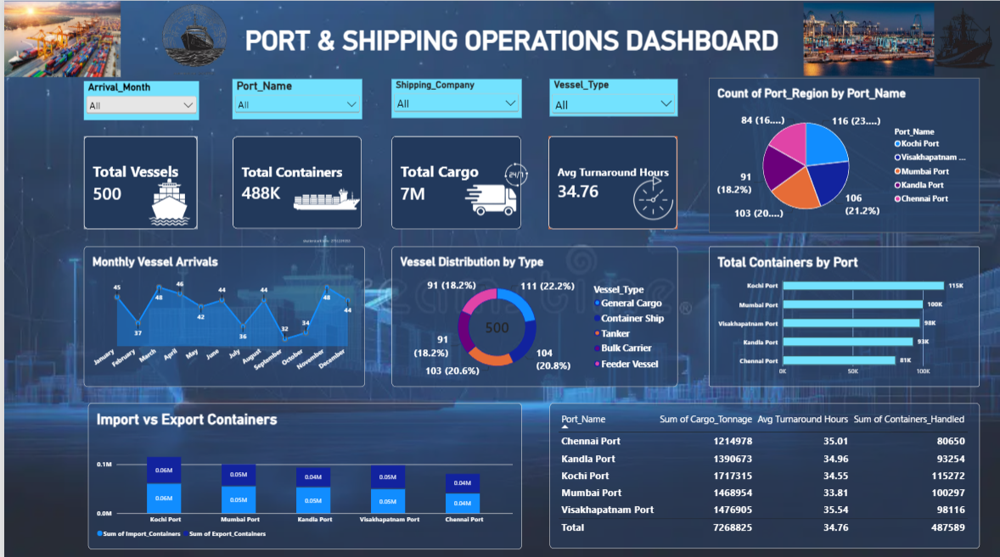
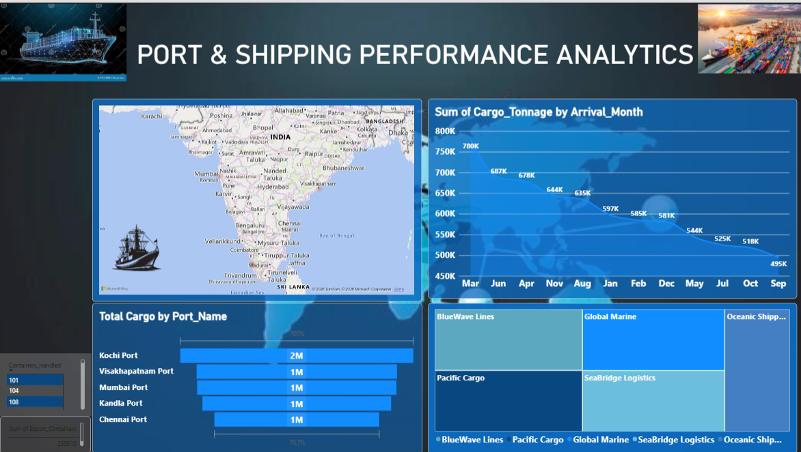

# 🚢 Port & Shipping Operations Dashboard

An interactive **Power BI** project that turns port and shipping data into clear, actionable insights on vessel activity, cargo movement, container handling and port performance.

The project contains **two complementary dashboard pages**: an operational overview and a deeper performance analysis.

---

## 📊 Dashboard Previews

### Dashboard 1 – Port & Shipping Operations


### Dashboard 2 – Port & Shipping Performance Analytics


---

## 🎯 Project Objective

Convert shipping and port data into clear, interactive business insights that support faster, data-driven decisions on port and shipping operations.

## 📌 Key Metrics

| Metric | Value |
| --- | --- |
| Total Vessels | 500 |
| Total Containers | 488K |
| Total Cargo | 7M tonnes |
| Avg Turnaround Hours | 34.76 |

## 🧩 Dashboard Details

### Dashboard 1 – Operational Overview
- **KPI cards:** Total Vessels, Total Containers, Total Cargo, Avg Turnaround Hours
- **Pie chart:** Count of port region by port name
- **Donut chart:** Vessel distribution by type
- **Line chart:** Monthly vessel arrivals
- **Clustered bar chart:** Total containers by port
- **Stacked column chart:** Import vs export containers
- **Table:** Cargo tonnage, average turnaround hours and containers handled per port
- **Slicers:** Arrival month, port name, shipping company, vessel type

### Dashboard 2 – Performance Analytics
- **Map:** Port locations and container-handling volume
- **Area chart:** Cargo tonnage by arrival month
- **Funnel chart:** Total cargo by port
- **Treemap:** Volume by shipping company
- **Supporting slicers:** Containers handled and export containers

## 🗂️ Dataset Fields

| Category | Fields |
| --- | --- |
| Vessel & location | `Vessel_ID`, `Vessel_Name`, `Port_Name`, `Shipping_Company`, `Vessel_Type` |
| Timing | `Arrival_Date`, `Departure_Date`, `Turnaround_Hours` |
| Volumes | `Containers_Handled`, `Import_Containers`, `Export_Containers`, `Cargo_Tonnage` |

**Ports covered:** Kochi, Visakhapatnam, Mumbai, Kandla, Chennai
**Vessel types:** General Cargo, Container Ship, Tanker, Bulk Carrier, Feeder Vessel

## 🔍 Sample Insights

- **Kochi Port** handles the most containers (about 115K) and the highest cargo tonnage among the five ports.
- **Chennai Port** handles the fewest containers (about 81K).
- Average turnaround is similar across ports, ranging from about **33.8 to 35.5 hours**.
- Vessels are spread fairly evenly across the five vessel types, each making up roughly 18–22% of the total.

## 🛠️ Tools Used

- **Microsoft Power BI Desktop** – data modelling, DAX, visualisation and reporting

## 🚀 How to Use

1. Download or clone this repository.
2. Open `Port and shipping dashboard.pbix` in **Power BI Desktop**.
3. Use the slicers to filter by month, port, shipping company or vessel type.
4. Switch between the two report pages to move from the overview to the detailed analysis.

> **Note:** The Map visual needs an internet connection and Bing Maps enabled in Power BI.

## 📁 Repository Structure

```
Port-and-Shipping-operation-dashboard/
├── Port and shipping dashboard.pbix   # Power BI project file
├── KAJA_power_BI_project_updated.pptx # Project presentation
├── images/
│   ├── dashboard1.png                 # Dashboard 1 screenshot
│   └── dashboard2.png                 # Dashboard 2 screenshot
└── README.md
```

## 👤 Author

**Kajendran A**
GitHub: [@Kajendran007](https://github.com/Kajendran007)
